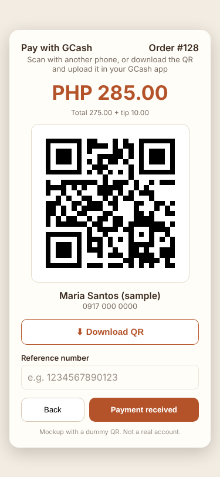

## Manual GCash / Maya QR Payments [Planned, high level]

Goal: let a shop that has **no payment gateway yet** take GCash or Maya by showing its **own static QR**. The customer
scans and pays, the cashier sees the money arrive in their own GCash/Maya app, then marks the order paid in the POS and
records the reference number. The app does not confirm the money itself.

Why: real gateways (PayMongo, HitPay, Xendit) need BIR 2303 and DTI/SEC papers, which the pilot shop may not have yet. This
is the stop-gap, and it is the "manual GCash fallback" that [cashless-payments](cashless-payments.md) already expects.

**Source tags:** [Repo] = checked in the code or docs on `main`. [Assumed] = my proposal or a guess to confirm.

### What the repo shows today

- [Repo] Payment methods are a fixed enum, `Cash = 1`, `GCash = 2` (`PaymentMethodEnum`), stored as `Orders.PaymentMethodId`
  against a small `PaymentMethods` table. GCash is only a label: nothing checks the money arrived.
- [Repo] The POS checkout modal picks the method; only Cash asks for amount received and shows change.
- [Repo] The customer link already lets a customer pick GCash, and the shop trusts it.
- [Repo] Reports group by `PaymentMethod.Name` (Payments report, Daily Close "Payments" section, dashboard breakdown).
- [Repo] Per-shop settings live in `TenantSettings` (Brand: name, logo, receipt header/footer, and so on), edited on the Brand
  page. Plan features are a comma list in `Plans.Features`, with a hard-coded catalog of keys.
- [Repo] `cashless-payments.md` already says: a static store QR is not verifiable per order, so it is **not** "cashless";
  manual GCash is an "unverified" fallback that must be reconcilable against the statement, and an offline GCash sale is
  flagged `PaymentUnverified` by the offline review (`offline.md`).
- [Repo] Multiple branches are planned or built on the release branch, not on `main`; I did not check the branch code.

### Recommended design

**1. Payment methods.** Add `Maya = 3` to the enum and `PaymentMethods` table (SQL script, idempotent). Keep "GCash" as is.
Both are "manual QR" methods. [Assumed] Do not add a generic "e-wallet" method; the shop wants GCash and Maya on separate
lines to match two separate statements.

**2. Where the QR and account details live.** A new "Payment QR" section in Brand settings (per shop), with for each of
GCash and Maya: an on/off switch, the QR image (existing image storage, a folder per tenant, so Stale Image Cleanup must
treat it as in use), the account name and the mobile number shown beside the QR. Per branch: **start per shop**, and add an
optional per-branch override later, because a branch can have its own wallet. [Assumed] Staff who can edit Brand
(Owner/Admin) can change it; changes are audited (a changed QR is a classic fraud move: someone swaps in their own).

**3. Checkout flow.** Choosing GCash or Maya in the checkout modal shows the QR full screen (customer-facing, large, with
the exact amount due = total + tip, account name and number). The cashier checks their own GCash/Maya app, then taps
"Payment received" and fills:
- **Reference number** (required, text, trimmed; GCash refs are 13 digits, Maya differ, so only a length/charset check).
  Reject a reference already used on another order of that tenant (duplicate check), with an Admin override that is audited.
- **Proof photo** (optional by default, [Assumed] setting "Require proof"): a screenshot or photo of the payer's receipt,
  stored like other images. Useful for disputes, not proof (screenshots are easy to fake).
Mockup (dummy QR, not a real account):  [820](manual-qr-payments-plan/qr-payment-screen-820.png) [1440](manual-qr-payments-plan/qr-payment-screen-1440.png)

**Two ways to pay (Pogi, 27 Nov 2026).** Customers usually either scan the QR with another phone, or save the QR image
and upload it in their own wallet app (GCash and Maya both read a QR from a saved image). So the payment screen must:
- show the QR image large and sharp (no compression, white margin kept so it scans), with the account name and number;
- have a **Download QR** button that saves the original image (file name such as `gcash-<shop>.png`) so it can be shared
  or saved to the phone gallery; on the customer link, the same image and button, so a customer on their own phone can save
  it and upload it in the wallet app;
- on Android (Capacitor) the button must save to the phone gallery (a plain browser download may not reach it); there is no separate Share button (decided);
- serve the image from the same cache used for offline so it also works with no internet, and only to signed-in staff or a
  valid customer link (not a public URL), so the QR cannot be scraped and swapped.
Upload on the Brand page should require a clear, square image and warn if it looks unreadable.

The order is then saved as paid with these fields. New columns on `Orders` (or a small `OrderPayments` row, to match
Phase 1 of cashless-payments so the later gateway reuses it; recommended): `Method`, `Reference`, `ProofImageId`,
`ConfirmedByUserId`, `ConfirmedAt`, `Status` = `Unverified` / `Verified`. The customer-link GCash choice stays "pay at pickup,
cashier confirms at the counter", so the same screen applies.

**4. Receipts and reports.** The receipt shows "GCash" or "Maya" and the reference (last 4 digits only on the printed copy).
Reports and Daily Close already group by method name, so Maya appears as its own line once added. Add the reference number and
a "Verified / Unverified" mark to order details and the Payments report rows (and its Excel/PDF/CSV, with the Total row
rule from Round 2). Counting as a sale: unchanged (an order marked paid counts), since the cashier is the trust point.

**5. Reconciliation.** New report under Reports > Operations (or the Payments report with a toggle): per day and method,
the orders, reference, amount, cashier and a **"Matched to statement" checkbox** the owner ticks while comparing with the
GCash/Maya statement (or a pasted/CSV statement list that auto-matches by reference and amount, later). Unticked entries
older than a day show on Needs Attention. Ticking sets `Verified`, audited (`PaymentConfirmed`). Daily Close shows
"Unverified GCash PHP x" so the closing count is honest. Calculations (matched vs unmatched totals) go in `WTF.Calculations`
with shared Angular cases, not in handlers.

**6. Plan gating.** New feature key `qrpayments`, [Assumed] Starter: a basic shop with no gateway is the main user, so do not
hide it behind Pro. Reconciliation report under `reports`. Following the gating rule, turning it off stops new use but never
hides history; the checkout hides the methods when the key is off or no QR is set up.

**7. Offline.** [Repo-consistent] A static QR needs no internet to show (cache the QR image in the offline catalog/lease), so
cashier can take a manual QR payment offline. The sale syncs as `Unverified` and the offline review flags `PaymentUnverified`
(already planned). The duplicate-reference check runs again on sync; a clash goes to review, never silently dropped.

**8. Tenant and branch scoping.** Everything is tenant-owned with the existing global filter. Reference uniqueness is per
tenant. The QR config is per tenant now; per-branch override later. Per-branch reconciliation filters by the order's branch.

**9. Permissions.** Cashiers can take and mark payments; changing the QR, overriding a duplicate reference and bulk-confirming
need Admin (add to the policy matrix tests). Voiding or refunding a QR payment is manual (shop refunds in their wallet);
the app records the reason.

### Risks

- **No automatic confirmation.** A cashier can mark paid without money received (theft) or trust a fake screenshot. Mitigate:
  reference required and unique, statement reconciliation, audit trail, unverified mark, manager review of Unverified daily.
- **QR swap / static QR paid by the wrong amount.** Show the exact amount beside the QR; the customer types it themselves, so
  the cashier must check the amount on their wallet, not the screenshot.
- **Payer privacy.** Proof images can show the payer's name and number; keep them private, expire after a set period (Stale
  Image Cleanup / retention setting), never in public routes. [Assumed] Data Privacy Act review.
- **Tax/legal.** Static personal wallets may not be ok for business income; the owner should confirm with their accountant
  and BIR. Receipts here are not official receipts.

### Later: swap in a gateway (PayMongo etc.) once BIR-registered

Keep the new `OrderPayments` shape from cashless-payments Phase 1 so manual QR is just `Provider = Manual`, status
`Unverified`. When a provider is added, dynamic QR plus webhook produce `Succeeded` payments with the same table, reports and
reconciliation; the manual QR remains the fallback when the provider is down (the design cashless-payments already
describes). Nothing built here is thrown away.

### Open questions (with my recommendation)

1. **Maya in scope now?** Yes: one more enum value and one more QR slot.
2. **Reference required?** Yes, with a duplicate check. Admin override only.
3. **Proof photo required?** Optional by default, a shop setting "Require proof" for shops that want it. Not proof by itself.
4. **QR per shop or per branch?** Per shop first, per-branch override later when a branch has its own wallet.
5. **Count unverified sales as sales?** Yes (same as GCash today), but show them as Unverified on Daily Close.
6. **Plan tier?** Starter, as a new key `qrpayments`.
7. **Separate `OrderPayments` table now, or columns on `Orders`?** Table now (small), so the gateway phase reuses it.
8. **Do the owners have a GCash/Maya Business or personal account?** Needs Pogi's answer; business accounts show merchant
   names on the QR and are better for BIR.

9. **Download only, no Share button. Decided (Pogi, 27 Nov 2026).** The payment screen has a Download QR button only.

### Rough build order

1. SQL (Maya, `OrderPayments`, QR settings), entities, `WTF.Calculations` reconciliation rules and shared cases.
2. Brand "Payment QR" settings and checkout screen (QR, reference, proof), customer-link confirm at counter.
3. Receipt, order details, Payments report and Daily Close lines; reconciliation report and Needs Attention.
4. Offline support, `PaymentUnverified` review, policy matrix tests, plan key, staging seed (believable GCash/Maya orders,
   some verified and some not), Playwright at 375/820/1440.
